# BuilderGate

**[English](#english) · [한국어](#한국어)**

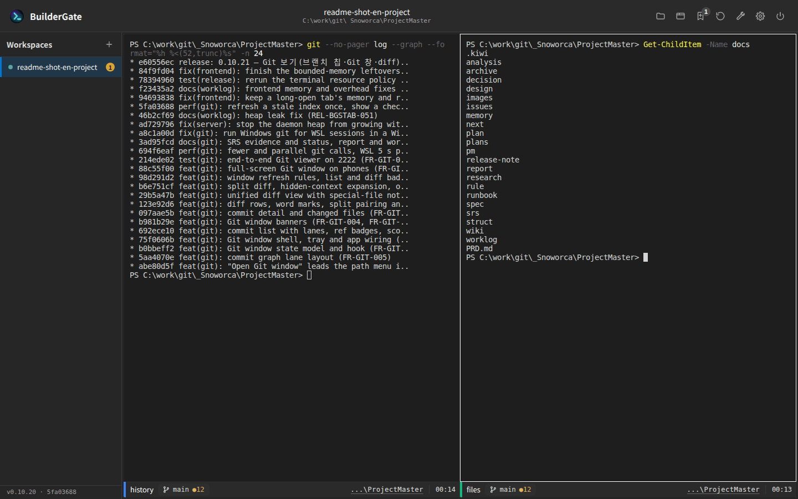

---

<a id="english"></a>

## English

> BuilderGate is under active development. APIs, configuration and UI may change without notice.

BuilderGate is a web-based workspace for running many coding agents (Claude Code, Codex, Hermes, OpenCode, …) in parallel. You open one browser tab and manage many shell sessions on one PC. Agents can talk to each other over MCP. A Git viewer, a file explorer and a markdown/code editor sit next to the terminals.

A typical day with BuilderGate:

1. Start BuilderGate on the PC that holds your projects.
2. Open `https://<that PC>:2002` from a desktop browser or a phone.
3. Make one Workspace per project and open a terminal session for each agent.
4. Watch the agents in a grid. Check their commits and diffs in the Git window. Drop files on a session to give them to the agent.
5. Before you restart the PC, save the sessions. After the restart, the agents continue the same conversations.

### Contents

- [Features](#features)
- [Download](#download)
- [Run](#run)
- [Command-line options](#command-line-options)
- [First login and password](#first-login-and-password)
- [Configuration](#configuration)
- [User guide](#user-guide)
  - [Workspaces, tabs and grid](#workspaces-tabs-and-grid)
  - [Terminal context menu](#terminal-context-menu)
  - [Git viewer](#git-viewer)
  - [Upload files by dropping them on a session](#upload-files-by-dropping-them-on-a-session)
  - [File explorer](#file-explorer)
  - [Editor and viewers](#editor-and-viewers)
  - [Tools menu](#tools-menu)
  - [MCP: letting agents work together](#mcp-letting-agents-work-together)
  - [Saving and restoring sessions](#saving-and-restoring-sessions)
  - [Phones and tablets](#phones-and-tablets)
  - [Settings and language](#settings-and-language)
- [Two-factor authentication](#two-factor-authentication)
- [Build](#build)
- [Development environment](#development-environment)
- [macOS notes](#macos-notes)

### Features

- **Web terminal** — many PTY sessions (xterm.js), as tabs or as a resizable grid. Paths that an agent prints can be opened with Ctrl+click.
- **Workspaces** — group sessions per project. There is no limit on the number of Workspaces or sessions. Each Workspace has a tab limit (default 8).
- **Git viewer (read-only)** — a branch chip under each session, and a Git window with the commit graph, commit details, changed files and a unified or split diff. *(new in 0.10.21)*
- **Drop files on a session** — files dropped from the desktop upload into that session's current folder. *(new in 0.10.20)*
- **File explorer** — tree and list views, new file and folder, upload, download (one file or a ZIP), archive extraction, drag to move or copy.
- **Editor and viewers** — markdown with live preview, code mode with syntax highlighting, image viewer, HTML viewer.
- **MCP control plane** — agents find each other's sessions, send messages, open new agent sessions, read terminals and open files in the editor.
- **Webhooks** — start an agent assignment from another system with a URL key.
- **Session save and restore** — automatic and manual saves. After a restart, each agent continues its conversation.
- **Phones and tablets** — full-screen windows, a terminal key bar, a special keyboard and touch gestures.
- **Security** — HTTPS, JWT, first-run password setup, optional TOTP 2FA.
- **English and Korean UI** — follows the browser language; you can change it in Settings.
- **Packaged executables** — Windows (ZIP and MSI), Linux and macOS (ZIP and Homebrew), run as a native daemon.

### Download

Release assets (GitHub Releases) each contain one top-level folder. Keep the folder together; do not copy the executable alone.

| Target | Release asset | Executable |
|---|---|---|
| Windows amd64 | `BuilderGate-win-amd64-<version>.zip` | `BuilderGate.exe` |
| Windows ARM64 | `BuilderGate-win-arm64-<version>.zip` | `BuilderGate.exe` |
| Linux amd64 | `BuilderGate-linux-amd64-<version>.tar.gz` | `buildergate` |
| Linux ARM64 | `BuilderGate-linux-arm64-<version>.tar.gz` | `buildergate` |
| macOS ARM64 | `BuilderGate-macos-arm64-<version>.zip` | `buildergate`, `BuilderGate.app` |

The folder contains the launcher, `config.json5` (runtime configuration), `web/` (frontend), `shell-integration/`, `runtime/` (daemon state, logs, TOTP secret, created on first run) and a copy of this README.

**Windows installer (MSI).** `BuilderGate-win-amd64-<version>.msi` and `BuilderGate-win-arm64-<version>.msi` install to `C:\Program Files\BuilderGate` (administrator approval required) and add *BuilderGate* and *Stop BuilderGate* to the Start Menu. An installed BuilderGate keeps `config.json5`, `data/`, `certs/` and `runtime/` in `%LOCALAPPDATA%\BuilderGate`, so installing a newer MSI over an older one keeps your settings, workspaces and saved sessions. Before it installs, the MSI stops a running BuilderGate on ports 2002 and 2001; it does not stop other programs. Uninstalling leaves the AppData folder in place; delete it yourself to remove your data. The zip (portable) build never writes to AppData: it keeps everything in its own folder as described above.

**macOS: Homebrew.** On an Apple Silicon Mac the command-line runtime installs with `brew install snoworca/tap/buildergate`. It installs the same runtime as the macOS ZIP, without `BuilderGate.app`. Settings, data and certificates stay in `$(brew --prefix)/var/buildergate`, so `brew upgrade` keeps them. `brew services start buildergate` starts it at login. The formula follows each release.

**Git.** The Git viewer runs the `git` command on the server PC. Install Git there if you want the branch chip and the Git window.

### Run

The default mode is the **native daemon**: the launcher starts the BuilderGate app process and a sentinel watchdog in the background and returns the console.

Windows:

```bat
BuilderGate.exe
BuilderGate.exe -p 2002
BuilderGate.exe --foreground -p 2002
BuilderGate.exe stop
```

Linux:

```bash
chmod +x ./buildergate
./buildergate
./buildergate -p 2002
./buildergate --foreground -p 2002
./buildergate stop
```

macOS ARM64:

```bash
chmod +x ./buildergate
./buildergate
./buildergate stop
open ./BuilderGate.app
```

Then open `https://localhost:2002` (the default port). A self-signed certificate is generated on first run, so the browser shows a certificate warning once. Health check:

```bash
curl -k https://localhost:2002/health
```

If BuilderGate is already running, a second start prints `BuilderGate is already running at https://localhost:<port>.` and exits.

### Command-line options

| Option | Meaning |
|---|---|
| *(none)* | Start as a native daemon (background app process + sentinel watchdog) |
| `stop` | Stop the running daemon (`BuilderGate.exe stop`, `./buildergate stop`) |
| `-p <port>`, `--port <port>` | HTTPS port. Overrides `server.port` in `config.json5` |
| `--foreground` | Run in the current console instead of daemon mode; stop with `Ctrl+C` |
| `--open` | Open the page in the default browser once the daemon is running (the MSI Start Menu shortcut uses it) |
| `--forground` | Legacy alias for `--foreground` |
| `--reset-password` | Clear `auth.password` in `config.json5` before launch (stop the daemon first) |
| `--bootstrap-allow-ip <ip[,ip]>` | Temporarily allow these IPs to set the first password remotely |
| `-h`, `--help` | Show the options |

Port priority: `-p` / `--port` → `server.port` in `config.json5` → default `2002`. The HTTP redirect port is one below the HTTPS port (2002 → 2001).

**First run.** On the first start from a folder (no `runtime/buildergate.daemon.json` yet), if the configured port is already used by another program, BuilderGate takes the next free port above it and saves it as `server.port` in `config.json5`; later starts keep that port. On later starts a port taken by another program is refused with a message instead of being changed. The packaged executable also opens the page in the default browser on its first start. Set `BUILDERGATE_NO_BROWSER=1` to prevent that.

`stop` only stops a daemon. A `--foreground` process is stopped with `Ctrl+C` in its own console.

### First login and password

When `auth.password` in `config.json5` is empty, the first visit shows an **initial password** screen instead of the login screen. This is allowed from localhost only; to do it from another device, start with `--bootstrap-allow-ip 192.168.0.50` (comma-separated for several).

Password rules: 4–128 characters of `A-Z a-z 0-9 !@#$%^&*()_+=/-` (no spaces, Hangul or emoji).

To reset the password:

```bat
BuilderGate.exe stop
BuilderGate.exe --reset-password
```

```bash
./buildergate stop
./buildergate --reset-password
```

To skip the login screen on the server PC itself, turn on `auth.localhostNoAuth` (Settings → Authentication). A browser on the same PC then opens the app directly. Connections from other computers still need the password and the second factor.

### Configuration

The executable reads `config.json5` next to it (`BUILDERGATE_CONFIG_PATH` overrides the path). It is JSON5, so comments are allowed. A plain-text password written into the file is encrypted to `enc(...)` on the next start; the key is derived from the machine, so an encrypted file does not decrypt on another machine.

```json5
{
  server: { port: 2002 },
  auth: { password: "", durationMs: 604800000, jwtSecret: "" },
  bootstrap: { allowedIps: [] },
  twoFactor: { enabled: false, externalOnly: false, issuer: "BuilderGate", accountName: "admin" },
  workspace: { maxTabsPerWorkspace: 8 },
}
```

Most settings can also be changed in **Settings** without a restart (see [Settings and language](#settings-and-language)).

When installed from the MSI, this file and the paths below are under `%LOCALAPPDATA%\BuilderGate`.

Useful paths: `runtime/buildergate-daemon.log`, `runtime/buildergate-sentinel.log`, `runtime/buildergate.daemon.json` (daemon state), `runtime/totp.secret`, `data/workspaces.json`, `data/session-autosave.json`, `data/session-snapshots/`.

### User guide

#### Workspaces, tabs and grid

The left sidebar lists **Workspaces**; `+` adds one. Each Workspace holds terminal sessions. Show them as tabs or as a grid; the grid/tab icon in the header switches the view. The bar under each session shows its name, the Git branch chip, its working directory and the elapsed time.

In tab view, a moving bright band on a tab's colour bar shows that its session is working. The band stops when the session becomes idle.

#### Terminal context menu

Right-click inside a terminal (on a touch screen: long press or double tap):

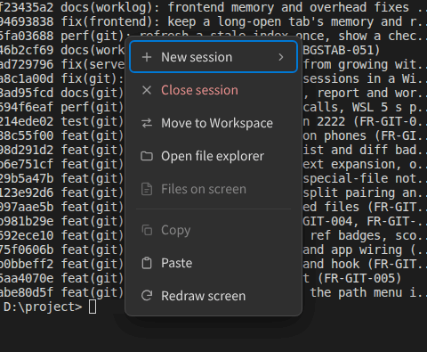

- **New session** — open another terminal next to this one. The submenu picks the shell (PowerShell, Command Prompt, WSL, …) and lists your saved **command lines** (see [Tools menu](#tools-menu)).
- **Close session**, **Move to Workspace**
- **Open file explorer** — open the explorer at this session's folder.
- **Open {name}** and **Files on screen** — open a file path that the terminal shows. The list holds only files that exist and can be opened.
- **Copy / Paste**
- **Redraw screen** — make the program in the terminal draw itself again at the real size. Use it when the screen looks broken.

**Open paths printed in the terminal.** When an agent prints a path such as `docs/design/main.html`, hold Ctrl (Cmd on macOS) and click the path. The path is underlined while you hold the key. Relative paths start from the session's current folder, and a line suffix such as `src/App.tsx:42` is ignored. The file opens as it does from the file explorer: HTML in the HTML viewer, images in the image viewer, code and Markdown in the editor.

**A session that waits for a GUI editor.** Some agents open an editor on the server PC (for example, Ctrl+G in Claude Code can open Notepad). The session then waits until that editor closes. BuilderGate shows a notice above the terminal with the editor's name and a **Close editor** button, so you can close it from the browser.

#### Git viewer

When a session's folder is in a Git repository, the session bar shows a **branch chip**. The Git viewer is read-only: it does not commit, push or change files.

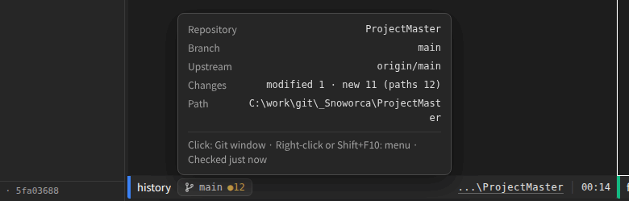

The chip shows:

- the branch (or `HEAD` and the commit when HEAD is detached),
- the number of changed paths,
- ahead and behind counts against the upstream,
- an operation in progress (merge, rebase, cherry-pick, revert, bisect).

When the bar gets narrow, the chip gets shorter in steps; the tooltip always has the full text. Until the first answer arrives, the chip shows a "Checking Git status" mark.

- **Point at the chip** to see the tooltip: repository, branch, upstream, changes and path.
- **Click the chip** to open the Git window.
- **Right-click the chip, or press Shift+F10**, to open its menu: **Show uncommitted changes**, **Compare: {base}**, **Copy branch name**, **Copy commit hash**, **Copy path**, **Path menu…**.

The session path menu also has **Open Git window**.

**The Git window**

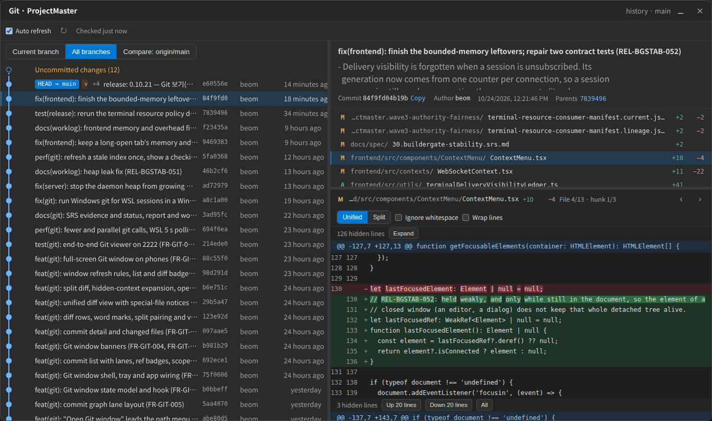

- **Commit list** with a graph. The scope buttons show the **Current branch**, **All branches**, or **Compare: {base}** (the commits since the fork point from the base branch). **Uncommitted changes** is always the first row.
- **Commit detail**: subject, message, commit hash with **Copy**, author, date and parents.
- **Changed files**. For uncommitted changes, the files are grouped as **Staged**, **Not staged**, **Untracked** and **Conflicts**.
- **Diff** of the selected file. Choose **Unified** or **Split**. You can also turn on **Ignore whitespace** and **Wrap lines**.
- **Hidden lines** between hunks open with **Expand**, **Up 20 lines**, **Down 20 lines** or **All**.
- **Open in editor** opens the working-tree file in the BuilderGate editor.
- `[` and `]` move to the previous and next file. **R** refreshes the window.

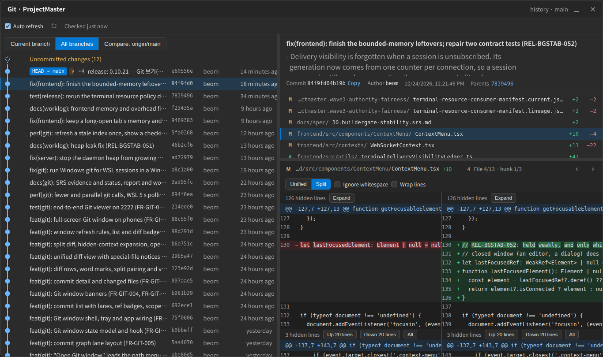

Some files show a notice instead of a line diff: binary files, large changes (over 512 KB or 5,000 lines; lock, dist and min files are folded by default), files where only permissions or only line endings changed, symbolic links, Git LFS files, submodules and files that are not UTF-8. For a large change, **Expand anyway** shows the diff.

The window keeps itself up to date. With **Auto refresh** on, it follows the repository. With it off, a badge says **New changes in the list · Apply** or **This file changed · Apply**. After you commit, the window moves to the new HEAD. You can minimize the window and open it again from the tray.

In a WSL session on a Windows drive (`/mnt/c/...`), BuilderGate uses Windows Git, because Linux Git is very slow on that path. While the browser tab is hidden, the chip does not ask the server for updates.

#### Upload files by dropping them on a session

Drag files or folders from the desktop over a terminal session. The session shows a yellow overlay: **Drop files here to upload**.

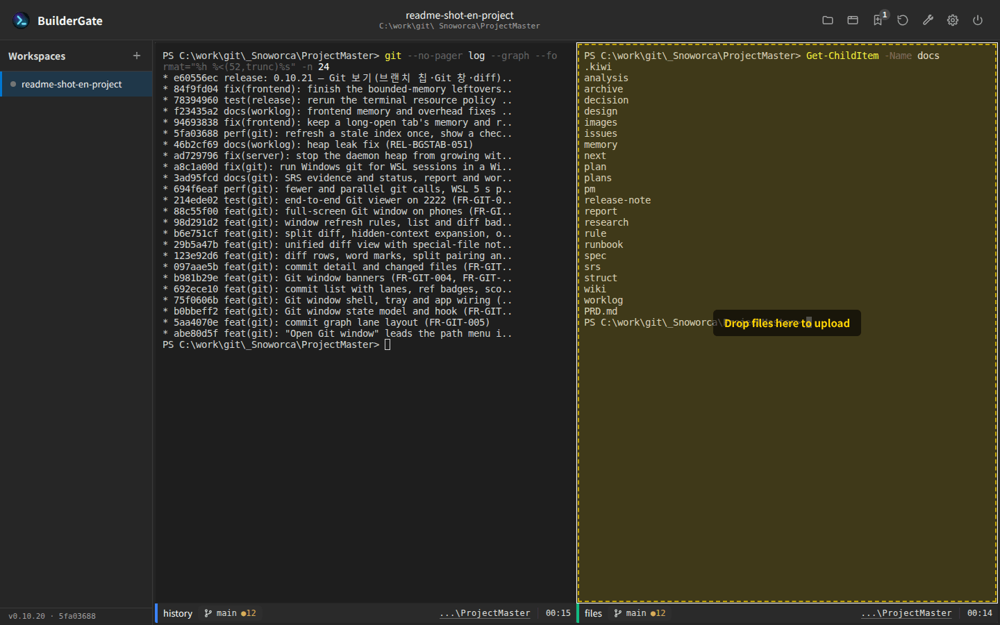

Release them to upload them into that session's current folder. The upload uses the same job as the file explorer, and its progress shows in the file-job bar at the bottom. BuilderGate never overwrites a file: if a name is already in the folder, the new file is kept as `name (2).ext`.

This works on a desktop browser only. A touch screen, or a window narrower than 768 px, shows no overlay.

#### File explorer

Open the explorer from the header folder icon, from the terminal menu, or from the session path menu.

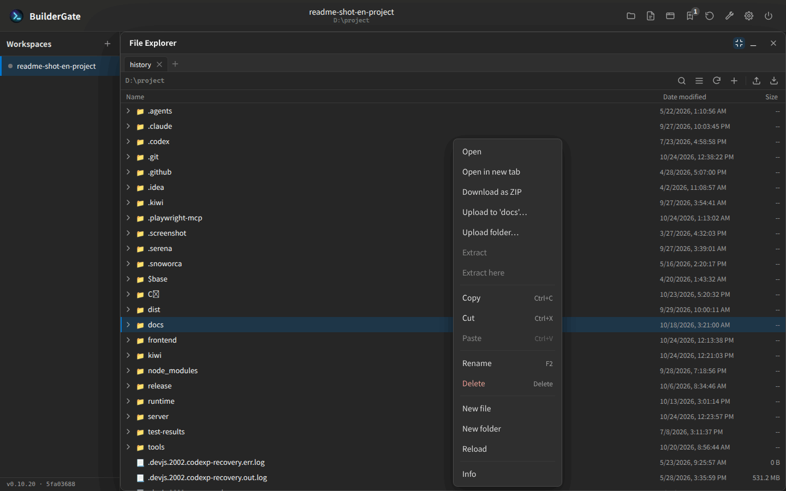

- **Tabs and views** — one tab per folder, tree or list view, search.
- **New file** and **New folder** — BuilderGate checks the name as you type and never overwrites an existing entry.
- **Upload** — use the upload button in the path bar, **Upload…** or **Upload folder…** in the menu, or drop files from the OS on the list or on a folder.
- **Download** — download one file, or **Download as ZIP** for several entries or a folder. `.git` and `node_modules` are left out. Above 1 GiB or 10,000 entries, a bar shows the totals and asks first.
- **Extract** and **Extract here** — for `.zip`, `.tar`, `.tar.gz` and `.tgz`. Unsafe entries (path traversal, absolute paths, links, devices) are skipped and listed. Encrypted and split ZIPs are refused.
- **Copy, Cut, Paste, Rename, Delete**.
- **Drag to move** (desktop) — drag entries onto a folder to move them. Hold Ctrl (Option on macOS) when you drop to copy them.

Long operations run as file jobs with progress. When a name already exists, BuilderGate asks you to skip the item or keep both.

#### Editor and viewers

Right-click the **path in a session's bar** to open the session path menu:

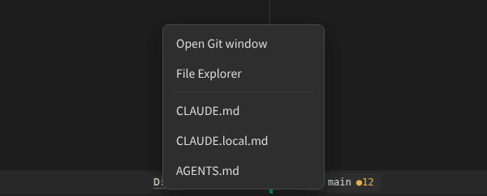

It opens the **Git window**, the **File Explorer**, or the agent instruction files of that project (`CLAUDE.md`, `CLAUDE.local.md`, `AGENTS.md`) in the built-in editor.

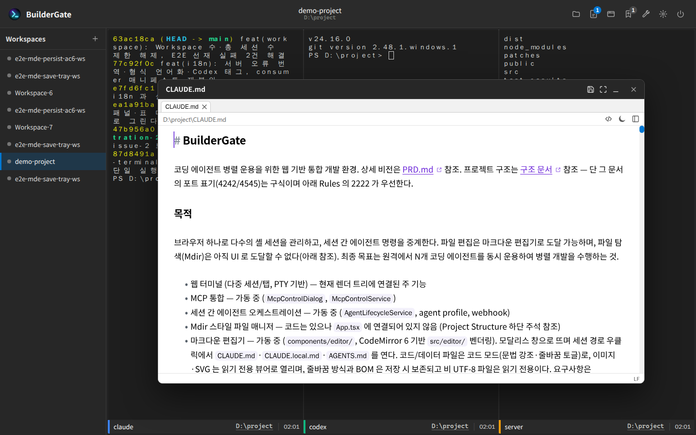

The editor opens as a window that does not block the rest of the app:

- **Markdown** with live preview.
- **Code files** in code mode, with syntax highlighting and a wrap toggle.
- **Images** in a read-only viewer. `‹ n / m ›` and the ←/→ keys move through the images of the same folder.
- **HTML files** with a **Rendered | Source** toggle. The rendered page runs in a sandbox and has no access to your BuilderGate login.

Line endings and the BOM are kept on save. Files that are not UTF-8 open read-only.

#### Tools menu

The wrench icon in the header:

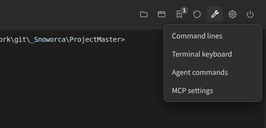

- **Command lines** — saved commands and text. Paste or run them in the active terminal, or start one as a new session from the terminal menu.
- **Terminal keyboard** — custom key bindings per profile and scope (for example, send a Codex newline on Shift+Enter).
- **Agent commands** — the commands you use to start Claude or Codex (for example, an alias that adds flags). BuilderGate treats these commands as the agent itself: it detects the session as an AI session, saves it and resumes it with the same command.
- **MCP settings** — see below.

#### MCP: letting agents work together

BuilderGate runs an **MCP server** (Streamable HTTP) that coding agents connect to. Through it an agent can find other sessions, send them messages, start new agent sessions and report back. Open **Tools → MCP settings**.

**1. Security tab — turn the endpoint on**

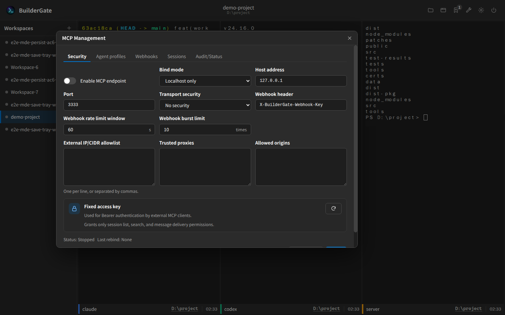

- Turn on **Enable MCP endpoint**. Choose the **bind mode** (localhost only / allowlist), the host and the **port** (default `3333`). The endpoint URL is `http://127.0.0.1:3333/mcp`.
- For access from other machines, use the allowlist, trusted proxies and TLS options.
- **Fixed access key** — a Bearer key for external MCP clients. It only grants listing, searching and messaging sessions.

**2. Agent profiles tab — agents BuilderGate may launch**

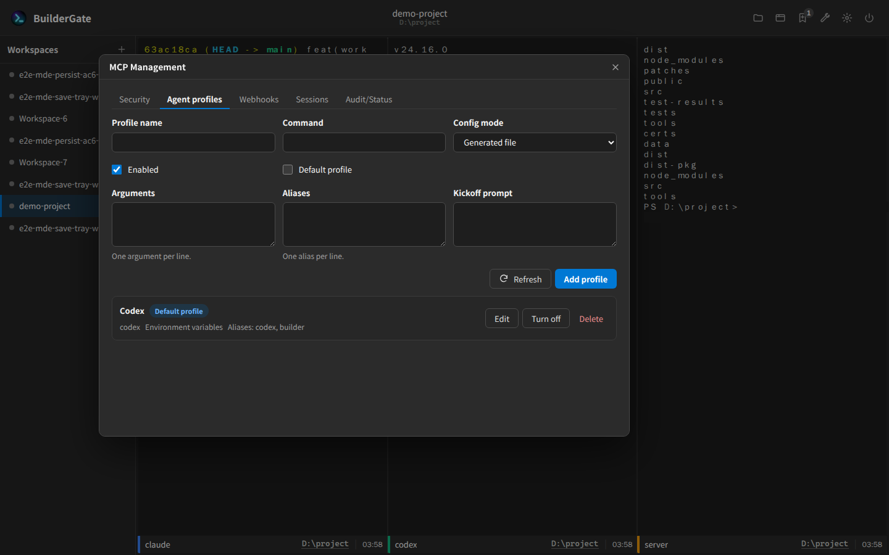

A profile is a name, a command (for example `codex`, `claude`), arguments, aliases and an optional kickoff prompt. **Config mode** decides how the launched agent receives its MCP connection (generated file, environment variables, or manual). A leader agent calls `buildergate.session.open_agent` with a profile to open a follower session.

**3. Webhooks tab — start work from outside**

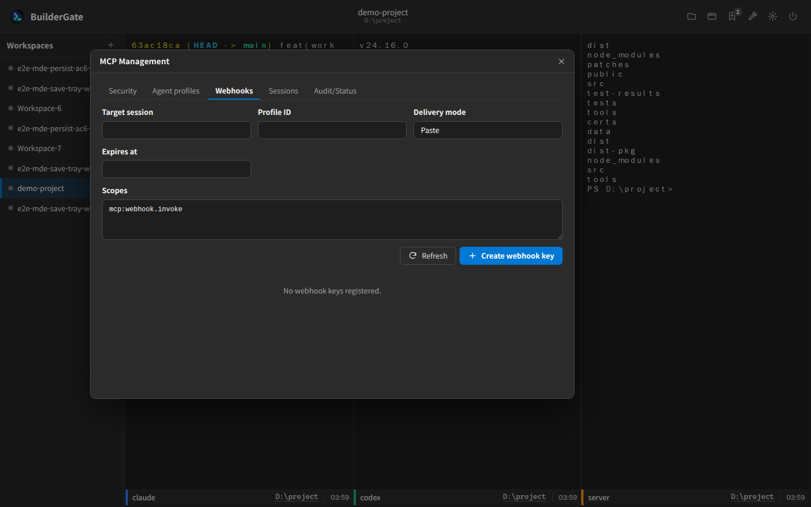

Create a webhook key bound to a target session or profile. An external system then calls:

```bash
curl -k -X POST "https://localhost:2002/webhook/agent?key=<webhook-key>" \
  -H "Content-Type: application/json" -d '{"prompt":"Run the nightly checks"}'
```

The prompt is delivered to the target (paste, send only, or send and press Enter). Before Enter, BuilderGate waits a short time so that the agent receives the whole prompt; you can change the wait in MCP settings.

**4. Sessions tab** lists live sessions with their stable session key. Here you can set an **alias**, **issue a connection code** (an agent in that terminal claims its identity with `buildergate.session.claim`), send a test message, or close the session. **Audit/Status** shows the listener state and the audit log.

**MCP tools available to agents**

| Tool | Purpose |
|---|---|
| `buildergate.session.whoami` / `buildergate.session.claim` | Identify the calling session (claim with a connection code) |
| `buildergate.session.list` / `buildergate.session.search` | Find sessions by name, alias or status |
| `buildergate.message.send` | Deliver a message into another session's terminal (`includeSender` adds a sender tag) |
| `buildergate.message.reply_to_leader` | Report back to the leader session |
| `buildergate.session.open_agent` | Launch a follower agent from a profile |
| `buildergate.session.set_alias` / `buildergate.session.update_status` | Name a session, publish progress |
| `buildergate.session.close` / `buildergate.session.close_self` | Close a follower (confirmation required) or itself |
| `buildergate.workspace.list` / `create` / `rename` / `delete` | Manage Workspaces (delete needs `confirm: true`) |
| `buildergate.terminal.list` / `create` / `delete` | Manage terminal sessions (delete needs `confirm: true`) |
| `buildergate.terminal.exec` | Run a command in a terminal and optionally return its screen text |
| `buildergate.terminal.read` | Read the last lines of a terminal without typing into it |
| `buildergate.editor.open_markdown` / `open_code` / `open_image` / `open_html` | Open a file in the browser's editor or viewer |

Each tool needs a matching permission scope (for example `mcp:terminals.exec` or `mcp:editor.open`).

Typical flow: a leader agent searches for or opens follower agents and sends each a task with `message.send`. The followers answer with `reply_to_leader`.

#### Saving and restoring sessions

BuilderGate can bring your terminals back after a restart or a crash. Each saved terminal comes back in its folder. Claude, Codex, Hermes and OpenCode sessions resume the same conversation.

- **Save sessions · Prepare to restart** (bookmark icon in the header) saves all terminals now, **without stopping the agents**. Each press adds one save to a list of manual saves.
- **Auto save** saves every terminal at a fixed interval (default every 5 minutes; set it, or turn it off, in Settings). It keeps one slot and overwrites it.
- **Restore sessions** (header button) opens the **Restore** tab. Pick a save and its terminals, and restore them by hand.
- At every start, BuilderGate restores the newer of the newest manual save and the auto save. A banner reports the result once.

Save again after you start a new conversation in an agent (`/clear`, `/new`).

#### Phones and tablets

BuilderGate works in a phone browser too.

- The file explorer, the editor and the Git window fill the screen. The Git window opens in three steps (list → commit → diff), and the browser's back button steps out.
- When the terminal has focus, a **key bar** above the system keyboard adds Esc, Tab, Ctrl, Alt, the arrow keys, Home, End, PgUp and PgDn. A short tap on Ctrl, Alt or Shift applies it to the next key; a longer hold locks it.
- The keyboard button opens a **special keyboard** with F1–F12, symbols, arrows and a number pad.
- Long press, or a double tap, opens the same context menus as a right-click.
- A one-finger drag in a full-screen program (vim, less, an agent TUI) scrolls like a mouse wheel.

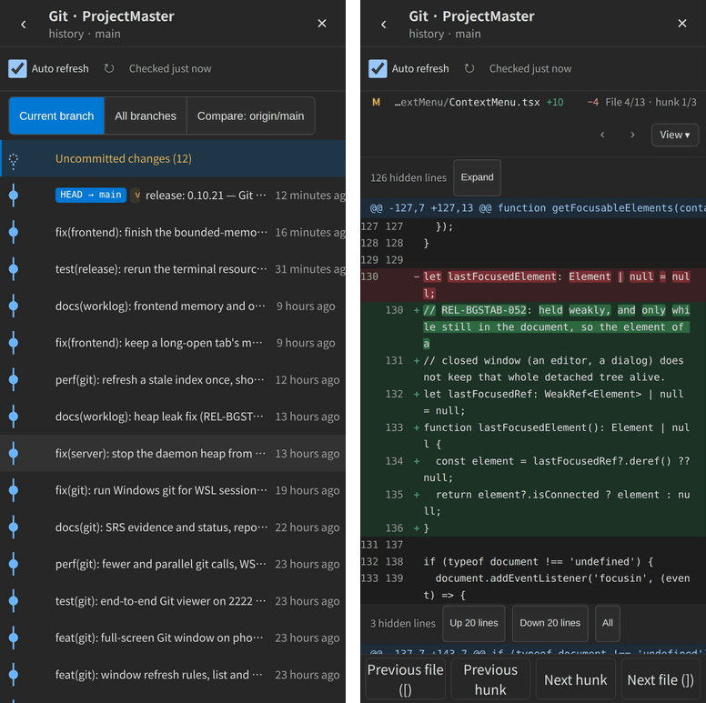

#### Settings and language

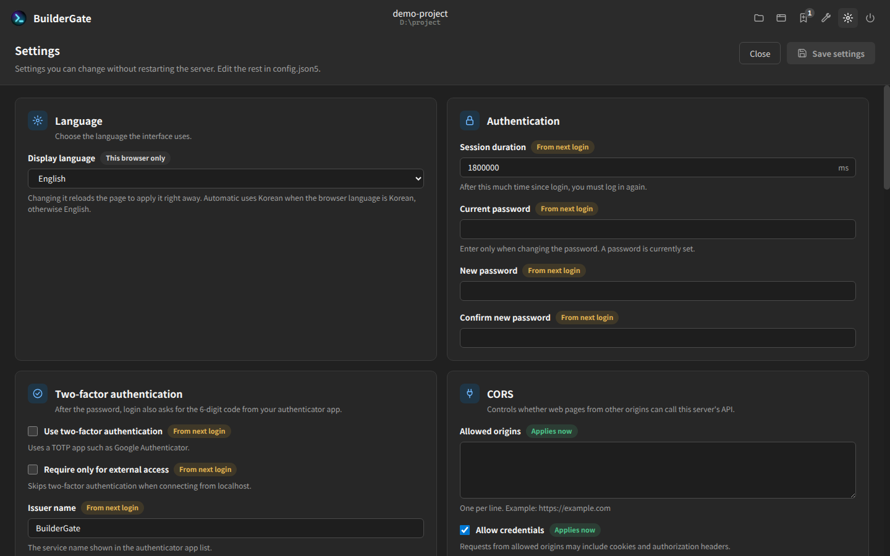

Settings holds everything that can change without a restart: session duration, password change, 2FA, skip login on this PC, CORS, terminal, session auto save, resource limits. The header shows the running version. **Language** switches the UI between Automatic (browser language: Korean if the browser is Korean, otherwise English), English and 한국어; the choice is stored per browser.

### Two-factor authentication

TOTP (Google Authenticator, 1Password, Authy, …). Enable it in Settings or in `config.json5` (`twoFactor.enabled: true`). In daemon mode, when a secret still has to be registered, the parent launcher prints the QR code and manual key to the console once, **before detach**; in `--foreground` mode the server prints the QR itself. `externalOnly: true` asks for the code only for non-localhost access. To re-register, stop the daemon, delete `runtime/totp.secret` and start again.

### Build

Building needs Node.js **22** and npm (running a release does not).

```bash
npm ci
npm ci --prefix server
npm ci --prefix frontend
npm run build                 # all supported targets
npm run build:windows-amd64   # or one target
npm run build:linux-amd64
npm run build:macos-arm64
```

Output goes to `dist/bin/<target>-<version>/`, e.g. `dist/bin/win-amd64-0.10.32/BuilderGate.exe`. Pushing a `v*.*.*` tag runs the GitHub Actions release workflow, which builds every target and publishes the release.

The Windows MSI is built from that folder with `node tools/build-msi.js --profile win-amd64` (or `win-arm64`) and lands in `dist/msi/`. It needs the WiX Toolset v5 CLI: `dotnet tool install --global wix --version 5.0.2`.

### Development environment

- Node.js 22+, npm, Git. Windows: PowerShell; node-pty uses prebuilt binaries.
- Repository layout: `server/` (Express + TypeScript, node-pty, WebSocket), `frontend/` (React 19, Vite 7, xterm.js 6), `tools/` (launcher, daemon, build scripts), `docs/spec/` (requirements, SpecKiwi SRS), `docs/release-note/` (release notes).
- Run from source (builds what is missing, then starts the server):

  ```bat
  start.bat --port 2222
  start.bat stop
  ```

  ```bash
  ./start.sh --port 2222
  ./start.sh stop
  ```

- Tests:

  ```bash
  cd server && npx tsx src/test-runner.ts                         # server runner
  cd server && npx tsx --test src/services/SessionManager.test.ts # one node:test file
  cd frontend && node --experimental-strip-types --test tests/unit/*.test.ts
  cd frontend && npx playwright test                              # E2E against https://localhost:2222
  npm run test:release-pipeline                                   # release guards
  ```

- UI text lives in `frontend/public/locales/messages.{en,ko}.json`; add a language by adding `messages.<lang>.json` and a line in `languages.json`.

### macOS notes

On an Apple Silicon Mac the command-line runtime can be installed with Homebrew: `brew install snoworca/tap/buildergate`. Settings and data stay in `$(brew --prefix)/var/buildergate`; `brew services start buildergate` starts it at login. The formula follows each release.

A ZIP downloaded from the internet may carry the Gatekeeper quarantine flag. For a release you trust: `xattr -dr com.apple.quarantine .` in the extracted folder. An unsigned local build can be ad-hoc signed with `codesign --force --deep --sign - ./BuilderGate.app`.

---

<a id="한국어"></a>

## 한국어

> BuilderGate 는 활발히 개발 중입니다. API, 설정 구조, UI 가 예고 없이 바뀔 수 있습니다.

BuilderGate 는 여러 코딩 에이전트(Claude Code, Codex, Hermes, OpenCode 등)를 병렬로 운용하기 위한 웹 기반 작업 환경입니다. 브라우저 탭 하나로 한 PC 의 여러 셸 세션을 관리합니다. 에이전트끼리는 MCP 로 대화합니다. 터미널 옆에서 Git 보기, 파일 탐색기, 마크다운·코드 편집기를 함께 씁니다.

BuilderGate 로 일하는 흐름은 대략 이렇습니다.

1. 프로젝트가 있는 PC 에서 BuilderGate 를 실행합니다.
2. 데스크톱 브라우저나 휴대폰에서 `https://<그 PC>:2002` 에 접속합니다.
3. 프로젝트마다 Workspace 를 하나 만들고, 에이전트마다 터미널 세션을 엽니다.
4. 에이전트들을 그리드로 지켜봅니다. 커밋과 diff 는 Git 창에서 확인하고, 에이전트에게 줄 파일은 세션 위에 끌어 놓습니다.
5. PC 를 재시작하기 전에 세션을 저장합니다. 재시작한 뒤 에이전트는 같은 대화를 이어 갑니다.

### 목차

- [주요 기능](#주요-기능)
- [내려받기](#내려받기)
- [실행](#실행)
- [실행 옵션](#실행-옵션)
- [최초 로그인과 비밀번호](#최초-로그인과-비밀번호)
- [설정 파일](#설정-파일)
- [사용 설명서](#사용-설명서)
  - [Workspace·탭·그리드](#workspace탭그리드)
  - [터미널 컨텍스트 메뉴](#터미널-컨텍스트-메뉴)
  - [Git 보기](#git-보기)
  - [세션에 파일을 끌어 놓아 업로드](#세션에-파일을-끌어-놓아-업로드)
  - [파일 탐색기](#파일-탐색기)
  - [편집기와 뷰어](#편집기와-뷰어)
  - [도구 메뉴](#도구-메뉴)
  - [MCP: 에이전트끼리 일하게 하기](#mcp-에이전트끼리-일하게-하기)
  - [세션 저장과 복구](#세션-저장과-복구)
  - [휴대폰과 태블릿](#휴대폰과-태블릿)
  - [설정과 언어](#설정과-언어)
- [2단계 인증](#2단계-인증)
- [빌드](#빌드)
- [개발 환경](#개발-환경)
- [macOS 참고](#macos-참고)

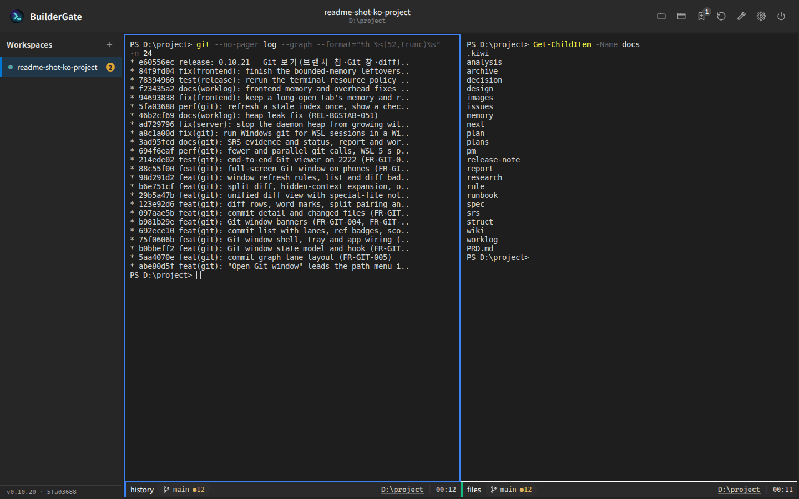

### 주요 기능

- **웹 터미널** — PTY 기반(xterm.js) 다중 세션을 탭이나 크기 조절 가능한 그리드로 봅니다. 에이전트가 출력한 경로는 Ctrl+클릭으로 엽니다.
- **Workspace** — 프로젝트별로 세션을 묶습니다. Workspace 개수와 세션 수에는 제한이 없고, Workspace 마다 탭 수 한도(기본 8개)만 있습니다.
- **Git 보기(읽기 전용)** — 세션마다 브랜치 칩이 붙고, Git 창에서 커밋 그래프·커밋 상세·변경 파일·한 줄/좌우 diff 를 봅니다. *(0.10.21 추가)*
- **세션에 파일 끌어 놓기** — 데스크톱에서 끌어 놓은 파일이 그 세션의 현재 폴더로 업로드됩니다. *(0.10.20 추가)*
- **파일 탐색기** — 트리·목록 보기, 새 파일과 새 폴더, 업로드, 다운로드(파일 하나 또는 ZIP), 압축 풀기, 끌어서 이동·복사.
- **편집기와 뷰어** — 미리보기가 있는 마크다운, 문법 강조 코드 모드, 이미지 뷰어, HTML 뷰어.
- **MCP 제어** — 에이전트가 다른 세션을 찾고, 메시지를 보내고, 새 에이전트 세션을 열고, 터미널을 읽고, 편집기로 파일을 엽니다.
- **웹훅** — URL 키로 다른 시스템에서 에이전트 작업을 시작합니다.
- **세션 저장과 복구** — 자동 저장과 직접 저장을 지원합니다. 재시작한 뒤 에이전트마다 하던 대화를 이어 갑니다.
- **휴대폰과 태블릿** — 전체 화면 창, 터미널 키 바, 특수 키보드, 터치 동작.
- **보안** — HTTPS, JWT, 최초 비밀번호 설정, 선택적 TOTP 2단계 인증.
- **영어·한국어 UI** — 브라우저 언어를 따르며 설정에서 바꿀 수 있습니다.
- **배포 실행 파일** — Windows(ZIP·MSI), Linux, macOS(ZIP·Homebrew)용 네이티브 데몬.

### 내려받기

GitHub Release 의 각 파일에는 최상위 폴더 하나가 들어 있습니다. 폴더를 통째로 두고 쓰며, 실행 파일만 따로 복사하지 않습니다.

| 대상 | Release 파일 | 실행 파일 |
|---|---|---|
| Windows amd64 | `BuilderGate-win-amd64-<version>.zip` | `BuilderGate.exe` |
| Windows ARM64 | `BuilderGate-win-arm64-<version>.zip` | `BuilderGate.exe` |
| Linux amd64 | `BuilderGate-linux-amd64-<version>.tar.gz` | `buildergate` |
| Linux ARM64 | `BuilderGate-linux-arm64-<version>.tar.gz` | `buildergate` |
| macOS ARM64 | `BuilderGate-macos-arm64-<version>.zip` | `buildergate`, `BuilderGate.app` |

폴더에는 런처, `config.json5`(실행 설정), `web/`(프런트엔드), `shell-integration/`, `runtime/`(데몬 상태·로그·TOTP secret, 첫 실행 때 생성), 이 README 복사본이 들어 있습니다.

**Windows 설치 프로그램(MSI).** `BuilderGate-win-amd64-<version>.msi`, `BuilderGate-win-arm64-<version>.msi` 는 `C:\Program Files\BuilderGate` 에 설치되고(관리자 승인 필요) 시작 메뉴에 *BuilderGate*·*Stop BuilderGate* 를 추가합니다. 설치형은 `config.json5`, `data/`, `certs/`, `runtime/` 을 `%LOCALAPPDATA%\BuilderGate` 에 두므로, 새 버전 MSI 를 설치해도 설정·Workspace·저장한 세션이 그대로 남습니다. 설치 전에 2002·2001 포트에서 실행 중인 BuilderGate 를 멈추며, 다른 프로그램은 멈추지 않습니다. 제거해도 AppData 폴더는 지우지 않으니 데이터까지 지우려면 직접 삭제하세요. zip(포터블) 판은 AppData 에 쓰지 않고 위처럼 자기 폴더에 모두 둡니다.

**macOS: Homebrew.** Apple Silicon Mac 에서는 `brew install snoworca/tap/buildergate` 로 명령줄 실행 파일을 설치합니다. macOS ZIP 과 같은 런타임이며 `BuilderGate.app` 은 들어 있지 않습니다. 설정·데이터·인증서는 `$(brew --prefix)/var/buildergate` 에 있어서 `brew upgrade` 해도 남습니다. `brew services start buildergate` 로 로그인할 때 시작합니다. formula 는 릴리즈마다 따라갑니다.

**Git.** Git 보기는 서버 PC 의 `git` 명령을 실행합니다. 브랜치 칩과 Git 창을 쓰려면 서버 PC 에 Git 을 설치하세요.

### 실행

기본 모드는 **네이티브 데몬**입니다. 런처가 BuilderGate 앱 프로세스와 sentinel watchdog 을 백그라운드로 띄우고 콘솔을 돌려줍니다.

Windows:

```bat
BuilderGate.exe
BuilderGate.exe -p 2002
BuilderGate.exe --foreground -p 2002
BuilderGate.exe stop
```

Linux:

```bash
chmod +x ./buildergate
./buildergate
./buildergate -p 2002
./buildergate --foreground -p 2002
./buildergate stop
```

macOS ARM64:

```bash
chmod +x ./buildergate
./buildergate
./buildergate stop
open ./BuilderGate.app
```

브라우저로 `https://localhost:2002`(기본 포트)에 접속합니다. 첫 실행 때 자체 서명 인증서를 만들므로 인증서 경고가 한 번 뜹니다. 상태 확인:

```bash
curl -k https://localhost:2002/health
```

이미 실행 중일 때 다시 시작하면 `BuilderGate is already running at https://localhost:<port>.` 한 줄을 출력하고 끝납니다.

### 실행 옵션

| 옵션 | 뜻 |
|---|---|
| *(없음)* | 네이티브 데몬으로 시작(백그라운드 앱 프로세스 + sentinel watchdog) |
| `stop` | 실행 중인 데몬 종료(`BuilderGate.exe stop`, `./buildergate stop`) |
| `-p <port>`, `--port <port>` | HTTPS 포트. `config.json5` 의 `server.port` 보다 우선 |
| `--foreground` | 데몬 대신 현재 콘솔에서 실행. `Ctrl+C` 로 종료 |
| `--open` | 데몬이 뜬 뒤 기본 브라우저로 페이지를 엽니다(MSI 시작 메뉴 바로가기가 사용) |
| `--forground` | `--foreground` 의 옛 오타 호환 별칭 |
| `--reset-password` | 시작 전에 `config.json5` 의 `auth.password` 를 비움(먼저 데몬 종료) |
| `--bootstrap-allow-ip <ip[,ip]>` | 최초 비밀번호를 원격에서 설정할 IP 를 임시로 허용 |
| `-h`, `--help` | 옵션 출력 |

포트 우선순위: `-p`/`--port` → `config.json5` 의 `server.port` → 기본값 `2002`. HTTP 리다이렉트 포트는 HTTPS 포트보다 1 작습니다(2002 → 2001).

**첫 실행.** 그 폴더에서 처음 시작할 때(`runtime/buildergate.daemon.json` 이 아직 없을 때) 설정된 포트를 다른 프로그램이 쓰고 있으면, 그보다 큰 빈 포트를 골라 `config.json5` 의 `server.port` 에 저장하고 이후에도 그 포트를 씁니다. 두 번째 실행부터는 포트를 바꾸지 않고, 다른 프로그램이 쓰고 있으면 안내 메시지와 함께 시작을 거부합니다. 패키지 실행 파일은 첫 실행 때 기본 브라우저로 페이지도 엽니다. 원하지 않으면 `BUILDERGATE_NO_BROWSER=1` 을 설정하세요.

`stop` 은 데몬만 종료합니다. `--foreground` 로 띄운 프로세스는 그 콘솔에서 `Ctrl+C` 로 종료합니다.

### 최초 로그인과 비밀번호

`config.json5` 의 `auth.password` 가 비어 있으면 첫 접속 때 로그인 화면 대신 **초기 비밀번호 설정** 화면이 뜹니다. 이 설정은 localhost 에서만 허용되며, 다른 장치에서 해야 한다면 `--bootstrap-allow-ip 192.168.0.50` 으로 시작합니다(여러 개는 쉼표로 구분).

비밀번호 규칙: `A-Z a-z 0-9 !@#$%^&*()_+=/-` 중 4~128자(공백·한글·이모지 불가).

비밀번호 초기화:

```bat
BuilderGate.exe stop
BuilderGate.exe --reset-password
```

```bash
./buildergate stop
./buildergate --reset-password
```

서버 PC 에서는 로그인 화면을 건너뛸 수 있습니다. `auth.localhostNoAuth` 를 켜면(설정 → 인증) 같은 PC 의 브라우저는 바로 앱을 엽니다. 다른 컴퓨터에서 접속하면 여전히 비밀번호와 2단계 인증을 거칩니다.

### 설정 파일

실행 파일은 같은 폴더의 `config.json5` 를 읽습니다(`BUILDERGATE_CONFIG_PATH` 가 있으면 그 경로가 우선). JSON5 라서 주석을 쓸 수 있습니다. 평문 비밀번호를 적으면 다음 시작 때 `enc(...)` 로 암호화됩니다. 키는 실행 머신에서 유도하므로 암호화된 파일은 다른 머신에서 복호화되지 않습니다.

```json5
{
  server: { port: 2002 },
  auth: { password: "", durationMs: 604800000, jwtSecret: "" },
  bootstrap: { allowedIps: [] },
  twoFactor: { enabled: false, externalOnly: false, issuer: "BuilderGate", accountName: "admin" },
  workspace: { maxTabsPerWorkspace: 8 },
}
```

대부분의 항목은 재시작 없이 **설정** 화면에서도 바꿀 수 있습니다([설정과 언어](#설정과-언어) 참고).

MSI 로 설치한 경우 이 파일과 아래 경로는 모두 `%LOCALAPPDATA%\BuilderGate` 아래에 있습니다.

주요 경로: `runtime/buildergate-daemon.log`, `runtime/buildergate-sentinel.log`, `runtime/buildergate.daemon.json`(데몬 상태), `runtime/totp.secret`, `data/workspaces.json`, `data/session-autosave.json`, `data/session-snapshots/`.

### 사용 설명서

#### Workspace·탭·그리드

왼쪽 사이드바에 **Workspace** 목록이 있고 `+` 로 추가합니다. Workspace 마다 터미널 세션을 담습니다. 세션은 탭이나 그리드로 볼 수 있고, 헤더의 그리드/탭 아이콘으로 전환합니다. 세션 아래 막대에는 이름, Git 브랜치 칩, 작업 디렉터리, 경과 시간이 나옵니다.

탭 보기에서는 세션이 일하는 동안 탭의 색 막대 위로 밝은 띠가 오갑니다. 세션이 쉬면 띠가 멈춥니다.

#### 터미널 컨텍스트 메뉴

터미널 안에서 마우스 오른쪽 버튼을 누릅니다(터치 화면에서는 길게 누르기나 두 번 탭).

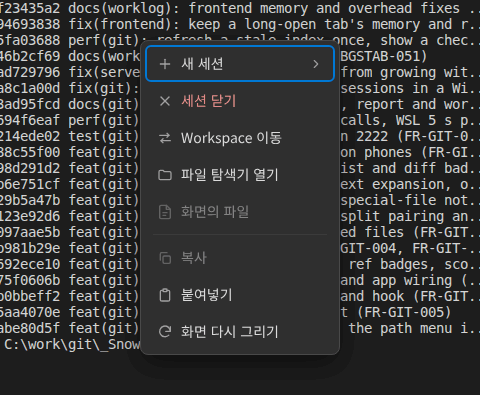

- **새 세션** — 옆에 터미널을 하나 더 엽니다. 하위 메뉴에서 셸(PowerShell, 명령 프롬프트, WSL 등)을 고르고, 등록해 둔 **명령줄**([도구 메뉴](#도구-메뉴) 참고)도 여기서 고릅니다.
- **세션 닫기**, **Workspace 이동**
- **파일 탐색기 열기** — 이 세션의 폴더에서 탐색기를 엽니다.
- **{이름} 열기**와 **화면의 파일** — 터미널에 보이는 파일 경로를 엽니다. 목록에는 실제로 있고 열 수 있는 파일만 나옵니다.
- **복사 / 붙여넣기**
- **화면 다시 그리기** — 터미널 안의 프로그램이 실제 크기로 화면을 다시 그리게 합니다. 화면이 깨져 보일 때 씁니다.

**터미널에 찍힌 경로 열기.** 에이전트가 `docs/design/main.html` 같은 경로를 출력하면, Ctrl(macOS 는 Cmd)을 누른 채 그 경로를 클릭합니다. 키를 누르고 있는 동안 경로에 밑줄이 생깁니다. 상대 경로는 세션의 현재 폴더를 기준으로 풀고, `src/App.tsx:42` 처럼 붙은 줄 번호는 무시합니다. 파일은 탐색기에서 열 때와 같이 열립니다. HTML 은 HTML 뷰어로, 이미지는 이미지 뷰어로, 코드와 마크다운은 편집기로 엽니다.

**GUI 편집기를 기다리는 세션.** 어떤 에이전트는 서버 PC 에 편집기를 띄웁니다(예: Claude Code 의 Ctrl+G 가 메모장을 엶). 그러면 세션은 편집기가 닫힐 때까지 기다립니다. BuilderGate 는 터미널 위에 편집기 이름과 **편집기 닫기** 버튼을 보여 주므로, 브라우저에서 바로 닫을 수 있습니다.

#### Git 보기

세션의 폴더가 Git 저장소 안에 있으면 세션 막대에 **브랜치 칩**이 나옵니다. Git 보기는 읽기 전용입니다. 커밋·푸시를 하거나 파일을 바꾸지 않습니다.

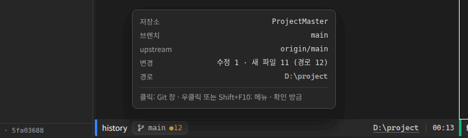

칩에는 다음이 보입니다.

- 브랜치(HEAD 가 분리된 상태면 `HEAD` 와 커밋)
- 바뀐 경로 수
- upstream 대비 앞섬·뒤처짐
- 진행 중인 작업(병합, 리베이스, 체리픽, 되돌리기, 이분 탐색)

막대가 좁아지면 칩도 단계별로 짧아지며, 전체 내용은 설명 창에 늘 남아 있습니다. 첫 응답이 오기 전에는 "Git 상태 확인 중" 표시가 먼저 뜹니다.

- **칩에 마우스를 올리면** 저장소, 브랜치, upstream, 변경, 경로를 보여 줍니다.
- **칩을 누르면** Git 창이 열립니다.
- **칩을 우클릭하거나 Shift+F10 을 누르면** 메뉴가 열립니다. **커밋 안 된 변경 보기**, **비교: {기준}**, **브랜치 이름 복사**, **커밋 해시 복사**, **경로 복사**, **경로 메뉴…** 가 있습니다.

세션 경로 메뉴에도 **Git 창 열기** 가 있습니다.

**Git 창**

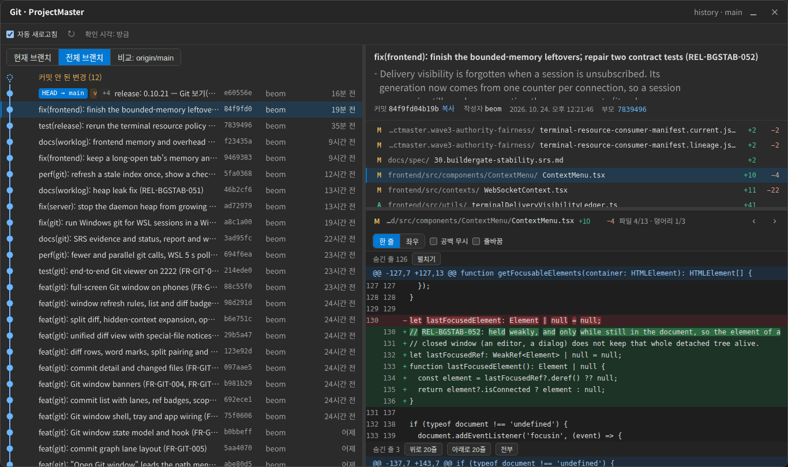

- **커밋 목록**은 그래프와 함께 나옵니다. 보기 범위 버튼으로 **현재 브랜치**, **전체 브랜치**, **비교: {기준}**(기준 브랜치에서 갈라진 뒤의 커밋)을 고릅니다. 맨 위 줄은 늘 **커밋 안 된 변경**입니다.
- **커밋 상세**에는 제목, 메시지, **복사** 버튼이 붙은 커밋 해시, 작성자, 날짜, 부모 커밋이 나옵니다.
- **변경 파일** 목록이 있습니다. 커밋 안 된 변경은 **스테이징됨**, **스테이징 안 됨**, **추적 안 됨**, **충돌**로 나눠 보여 줍니다.
- 고른 파일의 **diff** 는 **한 줄**과 **좌우** 중에서 고릅니다. **공백 무시**와 **줄바꿈**도 켤 수 있습니다.
- 덩어리 사이의 **숨긴 줄**은 **펼치기**, **위로 20줄**, **아래로 20줄**, **전부**로 엽니다.
- **편집기로 열기**는 작업 트리의 파일을 BuilderGate 편집기로 엽니다.
- `[` 와 `]` 로 이전·다음 파일로 가고, **R** 로 새로고침합니다.

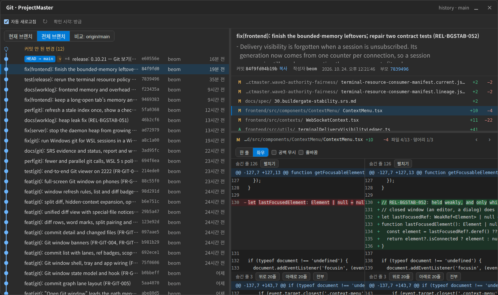

줄 단위 diff 대신 안내를 보여 주는 파일도 있습니다. 바이너리 파일, 큰 변경(512KB 또는 5,000줄 초과, lock·dist·min 파일은 기본으로 접음), 권한만 또는 줄 끝만 바뀐 파일, 심볼릭 링크, Git LFS 파일, 서브모듈, UTF-8 이 아닌 파일이 그렇습니다. 큰 변경은 **그래도 펼치기**로 diff 를 봅니다.

창은 스스로 갱신됩니다. **자동 새로고침**을 켜 두면 저장소를 따라갑니다. 끄면 **목록에 새 변경이 있습니다 · 적용**, **이 파일이 바뀌었습니다 · 적용** 배지가 뜹니다. 커밋하면 창이 새 HEAD 로 옮겨 갑니다. 창은 최소화했다가 트레이에서 다시 열 수 있습니다.

Windows 드라이브(`/mnt/c/...`) 안의 WSL 세션에서는 Windows Git 을 씁니다. 그 경로에서는 Linux Git 이 매우 느리기 때문입니다. 브라우저 탭이 가려져 있는 동안 칩은 서버에 상태를 묻지 않습니다.

#### 세션에 파일을 끌어 놓아 업로드

데스크톱에서 파일이나 폴더를 터미널 세션 위로 끌어옵니다. 세션에 노란 오버레이와 **이곳으로 파일 업로드** 문구가 뜹니다.


놓으면 그 세션의 현재 폴더로 올라갑니다. 파일 탐색기와 같은 업로드 작업을 쓰며, 진행 상황은 아래쪽 파일 작업 막대에 보입니다. 덮어쓰는 일은 없습니다. 폴더에 같은 이름이 있으면 새 파일을 `이름 (2).확장자` 로 보관합니다.

데스크톱 브라우저에서만 됩니다. 터치 화면이나 폭 768px 미만 창에서는 오버레이가 뜨지 않습니다.

#### 파일 탐색기

헤더의 폴더 아이콘, 터미널 메뉴, 세션 경로 메뉴에서 탐색기를 엽니다.

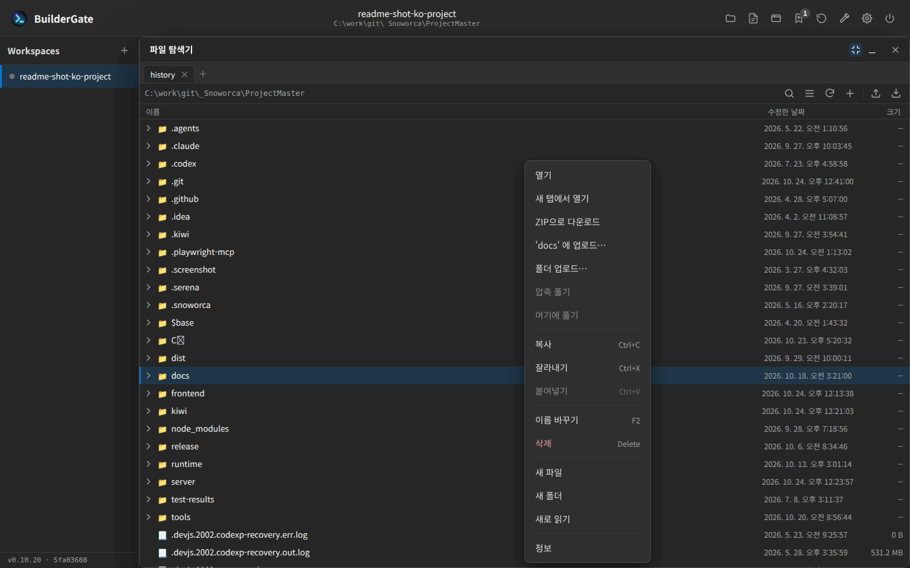

- **탭과 보기** — 폴더마다 탭 하나, 트리·목록 보기, 검색.
- **새 파일**과 **새 폴더** — 입력하는 동안 이름을 검사하며, 이미 있는 항목을 덮어쓰지 않습니다.
- **업로드** — 경로 막대의 업로드 버튼, 메뉴의 **업로드…**·**폴더 업로드…** 를 쓰거나, OS 에서 파일을 목록이나 폴더 위에 끌어 놓습니다.
- **다운로드** — 파일 하나를 받거나, 여러 항목이나 폴더를 **ZIP으로 다운로드**합니다. `.git` 과 `node_modules` 는 빠집니다. 1GiB 또는 10,000개를 넘으면 합계를 먼저 보여 주고 묻습니다.
- **압축 풀기**와 **여기에 풀기** — `.zip`, `.tar`, `.tar.gz`, `.tgz` 를 풉니다. 위험한 항목(경로 탈출, 절대 경로, 링크, 장치)은 건너뛰고 목록으로 알려 줍니다. 암호가 걸린 ZIP 과 분할 ZIP 은 거부합니다.
- **복사, 잘라내기, 붙여넣기, 이름 바꾸기, 삭제**.
- **끌어서 이동**(데스크톱) — 항목을 폴더 위로 끌어 놓으면 옮깁니다. 놓을 때 Ctrl(macOS 는 Option)을 누르고 있으면 복사합니다.

오래 걸리는 작업은 진행 표시가 있는 파일 작업으로 돕니다. 같은 이름이 있으면 건너뛸지, 둘 다 보관할지 묻습니다.

#### 편집기와 뷰어

세션 막대의 **경로**를 마우스 오른쪽 버튼으로 누르면 경로 메뉴가 열립니다.

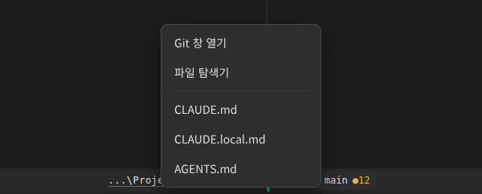

여기서 **Git 창**이나 **파일 탐색기**를 열거나, 그 프로젝트의 에이전트 지침 파일(`CLAUDE.md`, `CLAUDE.local.md`, `AGENTS.md`)을 내장 편집기로 엽니다.

편집기는 다른 작업을 막지 않는 창으로 열립니다.

- **마크다운**은 미리보기와 함께 엽니다.
- **코드 파일**은 코드 모드(문법 강조, 줄바꿈 토글)로 엽니다.
- **이미지**는 읽기 전용 뷰어로 엽니다. `‹ n / m ›` 와 ←/→ 키로 같은 폴더의 이미지를 넘깁니다.
- **HTML 파일**은 **렌더링 | 소스** 전환과 함께 엽니다. 렌더링된 페이지는 샌드박스에서 돌며 BuilderGate 로그인 정보에 접근하지 못합니다.

저장할 때 줄바꿈 방식과 BOM 을 보존합니다. UTF-8 이 아닌 파일은 읽기 전용으로 엽니다.

#### 도구 메뉴

헤더의 렌치 아이콘을 누릅니다.

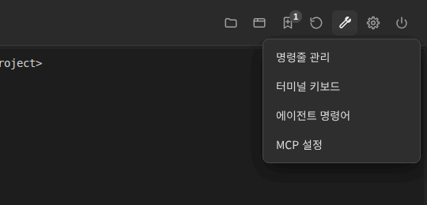

- **명령줄 관리** — 저장해 둔 명령과 문구입니다. 활성 터미널에 붙여넣거나 실행하고, 터미널 메뉴에서 새 세션으로 시작할 수도 있습니다.
- **터미널 키보드** — 프로필·범위별 단축키(예: Shift+Enter 로 Codex 줄바꿈 보내기).
- **에이전트 명령어** — Claude 나 Codex 를 실행할 때 쓰는 명령어(예: 플래그를 붙인 별칭)를 등록합니다. 등록한 명령어는 에이전트 자체로 취급되어, AI 세션으로 인식되고 저장되며 같은 명령어로 이어서 실행됩니다.
- **MCP 설정** — 아래 참고.

#### MCP: 에이전트끼리 일하게 하기

BuilderGate 는 코딩 에이전트가 접속하는 **MCP 서버**(Streamable HTTP)를 띄웁니다. 에이전트는 이를 통해 다른 세션을 찾고, 메시지를 보내고, 새 에이전트 세션을 열고, 결과를 회신합니다. **도구 → MCP 설정**을 엽니다.

**1. 보안 탭 — 엔드포인트 켜기**

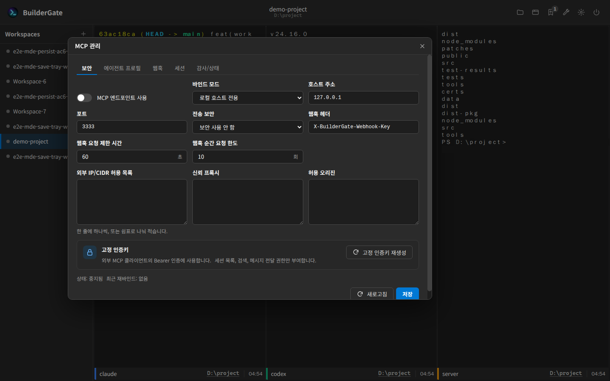

- **MCP 엔드포인트 사용**을 켭니다. **바인드 방식**(로컬 호스트 전용 / 허용 목록), 호스트, **포트**(기본 `3333`)를 고릅니다. 엔드포인트 주소는 `http://127.0.0.1:3333/mcp` 입니다.
- 다른 머신에서 접속하려면 허용 목록, 신뢰 프록시, TLS 옵션을 씁니다.
- **고정 인증키** — 외부 MCP 클라이언트용 Bearer 키입니다. 세션 목록·검색·메시지 전달 권한만 줍니다.

**2. 에이전트 프로필 탭 — BuilderGate 가 띄울 수 있는 에이전트**

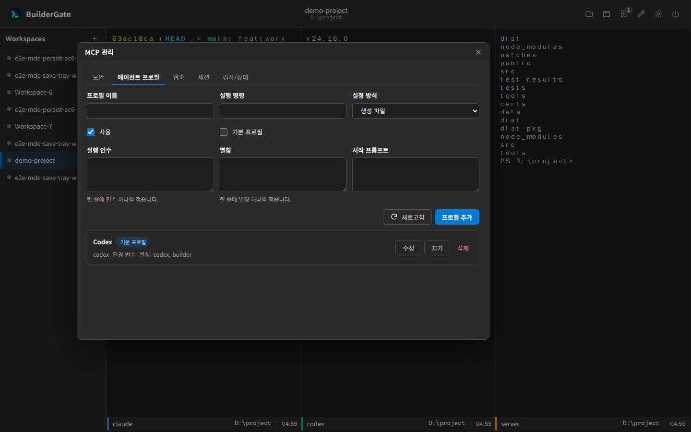

프로필은 이름, 실행 명령(예: `codex`, `claude`), 인수, 별칭, 시작 프롬프트로 이루어집니다. **설정 방식**은 띄운 에이전트가 MCP 연결 정보를 받는 방법(생성 파일, 환경 변수, 수동)을 정합니다. 리더 에이전트가 프로필을 지정해 `buildergate.session.open_agent` 를 부르면 팔로워 세션이 열립니다.

**3. 웹훅 탭 — 외부에서 작업 시작**

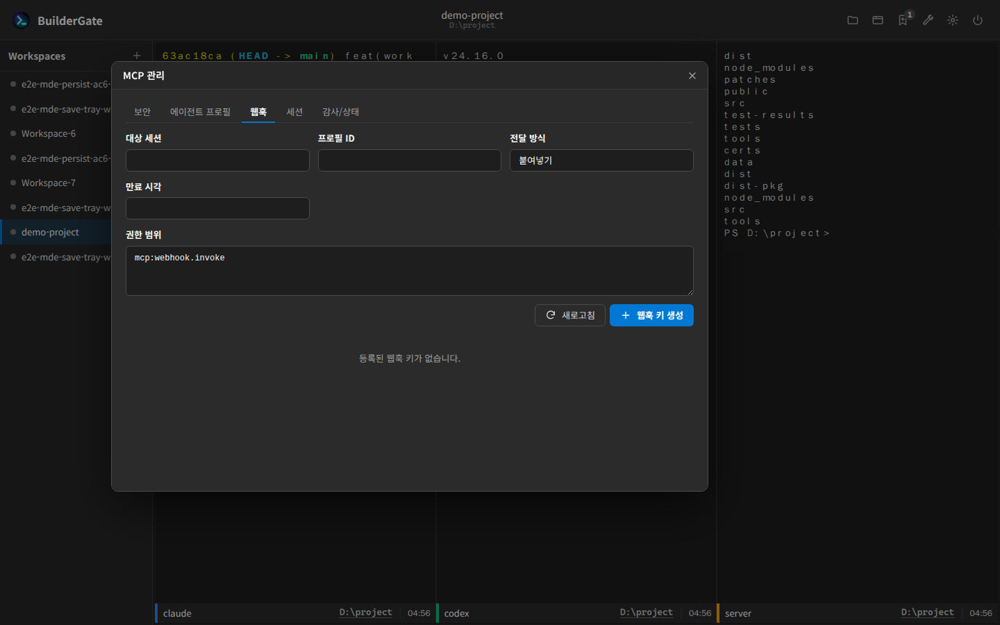

대상 세션이나 프로필에 묶인 웹훅 키를 만듭니다. 외부 시스템은 다음처럼 호출합니다.

```bash
curl -k -X POST "https://localhost:2002/webhook/agent?key=<webhook-key>" \
  -H "Content-Type: application/json" -d '{"prompt":"야간 점검을 실행해"}'
```

프롬프트가 대상에 전달됩니다(붙여넣기, 전송 전용, 전송 후 엔터 중 선택). 에이전트가 프롬프트를 다 받도록 엔터 전에 잠시 기다리며, 대기 시간은 MCP 설정에서 바꿉니다.

**4. 세션 탭**은 실행 중인 세션을 고정 세션 키와 함께 보여 줍니다. 여기서 **별칭**을 정하고, **연결 코드 발급**(그 터미널에서 도는 에이전트가 `buildergate.session.claim` 으로 자기 신원을 확인)을 하고, 테스트 메시지를 보내거나 세션을 닫습니다. **감사/상태** 탭은 리스너 상태와 감사 기록을 보여 줍니다.

**에이전트가 쓰는 MCP 도구**

| 도구 | 용도 |
|---|---|
| `buildergate.session.whoami` / `buildergate.session.claim` | 호출한 세션 확인(연결 코드로 claim) |
| `buildergate.session.list` / `buildergate.session.search` | 이름·별칭·상태로 세션 찾기 |
| `buildergate.message.send` | 다른 세션의 터미널로 메시지 전달(`includeSender` 로 보낸 쪽 표시) |
| `buildergate.message.reply_to_leader` | 리더 세션에 회신 |
| `buildergate.session.open_agent` | 프로필로 팔로워 에이전트 실행 |
| `buildergate.session.set_alias` / `buildergate.session.update_status` | 세션 이름 붙이기, 진행 상태 알리기 |
| `buildergate.session.close` / `buildergate.session.close_self` | 팔로워 닫기(확인 필요) 또는 자기 자신 닫기 |
| `buildergate.workspace.list` / `create` / `rename` / `delete` | Workspace 관리(삭제는 `confirm: true` 필요) |
| `buildergate.terminal.list` / `create` / `delete` | 터미널 세션 관리(삭제는 `confirm: true` 필요) |
| `buildergate.terminal.exec` | 터미널에서 명령을 실행하고, 원하면 화면 내용을 돌려받기 |
| `buildergate.terminal.read` | 입력 없이 터미널의 마지막 줄들 읽기 |
| `buildergate.editor.open_markdown` / `open_code` / `open_image` / `open_html` | 브라우저의 편집기나 뷰어로 파일 열기 |

도구마다 맞는 권한 범위(예: `mcp:terminals.exec`, `mcp:editor.open`)가 필요합니다.

보통은 이렇게 씁니다. 리더 에이전트가 팔로워를 찾거나 열고, `message.send` 로 각자에게 일을 줍니다. 팔로워는 `reply_to_leader` 로 답합니다.

#### 세션 저장과 복구

BuilderGate 는 재시작이나 비정상 종료 뒤에 터미널을 되살립니다. 저장한 터미널은 원래 폴더에서 다시 열리고, Claude·Codex·Hermes·OpenCode 세션은 같은 대화를 이어 갑니다.

- 헤더의 책갈피 아이콘(**세션 저장 · 재시작 준비**)은 **에이전트를 멈추지 않고** 지금 모든 터미널을 저장합니다. 누를 때마다 직접 저장 목록에 하나씩 쌓입니다.
- **자동 저장**은 정해진 간격(기본 5분)마다 모든 터미널을 저장합니다. 간격과 사용 여부는 설정에서 바꿉니다. 자동 저장본은 하나뿐이며 매번 덮어씁니다.
- 헤더의 **세션 복구** 버튼은 **복구** 탭을 엽니다. 저장본과 터미널을 골라 직접 복구합니다.
- BuilderGate 는 시작할 때마다 가장 최근 직접 저장본과 자동 저장본 중 더 최근 것을 복구합니다. 결과는 배너로 한 번 알려 줍니다.

에이전트에서 새 대화를 시작했다면(`/clear`, `/new`) 다시 저장하세요.

#### 휴대폰과 태블릿

휴대폰 브라우저에서도 BuilderGate 를 씁니다.

- 파일 탐색기, 편집기, Git 창이 화면 전체를 채웁니다. Git 창은 목록 → 커밋 → diff 세 단계로 열리며, 브라우저의 뒤로 가기로 한 단계씩 나옵니다.
- 터미널에 포커스가 있으면 시스템 키보드 위에 **키 바**가 붙습니다. Esc, Tab, Ctrl, Alt, 방향키, Home, End, PgUp, PgDn 이 있습니다. Ctrl·Alt·Shift 는 짧게 누르면 다음 한 키에만 걸리고, 길게 누르면 잠깁니다.
- 키보드 버튼을 누르면 F1–F12, 기호, 방향키, 숫자패드가 있는 **특수 키보드**가 열립니다.
- 길게 누르거나 두 번 탭하면 우클릭과 같은 메뉴가 열립니다.
- 전체 화면 프로그램(vim, less, 에이전트 TUI)에서 한 손가락으로 끌면 마우스 휠처럼 스크롤합니다.


#### 설정과 언어

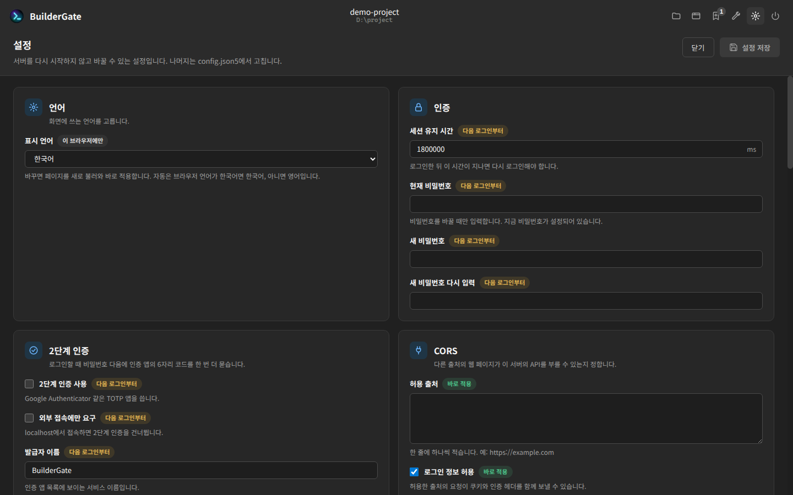

설정 화면에는 재시작 없이 바꿀 수 있는 항목이 모여 있습니다. 세션 유지 시간, 비밀번호 변경, 2단계 인증, 이 PC 에서 로그인 건너뛰기, CORS, 터미널, 세션 자동 저장, 자원 한도가 있습니다. 헤더에는 실행 중인 버전이 나옵니다. **언어**는 자동(브라우저 언어가 한국어면 한국어, 아니면 영어), English, 한국어 중에서 고르며, 선택은 브라우저별로 저장됩니다.

### 2단계 인증

TOTP(Google Authenticator, 1Password, Authy 등)를 지원합니다. 설정 화면이나 `config.json5`(`twoFactor.enabled: true`)에서 켭니다. 데몬 모드에서 secret 등록이 필요하면 부모 런처가 **detach 전**에 QR 코드와 수동 입력 키를 콘솔에 한 번 출력하고, `--foreground` 모드에서는 서버가 직접 QR 을 출력합니다. `externalOnly: true` 면 localhost 가 아닌 접속에만 코드를 요구합니다. 다시 등록하려면 데몬을 종료하고 `runtime/totp.secret` 을 지운 뒤 다시 시작합니다.

### 빌드

빌드에는 Node.js **22** 와 npm 이 필요합니다(배포본 실행에는 필요 없음).

```bash
npm ci
npm ci --prefix server
npm ci --prefix frontend
npm run build                 # 지원하는 모든 대상
npm run build:windows-amd64   # 또는 대상 하나
npm run build:linux-amd64
npm run build:macos-arm64
```

결과는 `dist/bin/<target>-<version>/` 에 생깁니다(예: `dist/bin/win-amd64-0.10.32/BuilderGate.exe`). `v*.*.*` 태그를 푸시하면 GitHub Actions 릴리즈 워크플로가 모든 대상을 빌드해 릴리즈에 올립니다.

Windows MSI 는 그 폴더로 `node tools/build-msi.js --profile win-amd64`(또는 `win-arm64`)를 실행해 만들며 `dist/msi/` 에 생깁니다. WiX Toolset v5 CLI 가 필요합니다: `dotnet tool install --global wix --version 5.0.2`.

### 개발 환경

- Node.js 22 이상, npm, Git. Windows 는 PowerShell 을 쓰며 node-pty 는 미리 빌드된 바이너리를 씁니다.
- 저장소 구조: `server/`(Express + TypeScript, node-pty, WebSocket), `frontend/`(React 19, Vite 7, xterm.js 6), `tools/`(런처·데몬·빌드 스크립트), `docs/spec/`(요구사항, SpecKiwi SRS), `docs/release-note/`(릴리즈 노트).
- 소스에서 실행(없는 빌드를 만든 뒤 서버 시작):

  ```bat
  start.bat --port 2222
  start.bat stop
  ```

  ```bash
  ./start.sh --port 2222
  ./start.sh stop
  ```

- 테스트:

  ```bash
  cd server && npx tsx src/test-runner.ts                         # 서버 러너
  cd server && npx tsx --test src/services/SessionManager.test.ts # node:test 파일 하나
  cd frontend && node --experimental-strip-types --test tests/unit/*.test.ts
  cd frontend && npx playwright test                              # https://localhost:2222 대상 E2E
  npm run test:release-pipeline                                   # 릴리즈 가드
  ```

- UI 문구는 `frontend/public/locales/messages.{en,ko}.json` 에 있습니다. `messages.<lang>.json` 을 추가하고 `languages.json` 에 한 줄을 넣으면 언어가 늘어납니다.

### macOS 참고

Apple Silicon Mac 에서는 Homebrew 로 명령줄 실행 파일을 설치할 수 있습니다: `brew install snoworca/tap/buildergate`. 설정과 데이터는 `$(brew --prefix)/var/buildergate` 에 남고, `brew services start buildergate` 로 로그인 때 시작합니다. formula 는 릴리즈마다 따라갑니다.

인터넷에서 받은 ZIP 에는 Gatekeeper quarantine 이 붙을 수 있습니다. 신뢰하는 배포본이면 압축을 푼 폴더에서 `xattr -dr com.apple.quarantine .` 로 지웁니다. 서명되지 않은 로컬 빌드는 `codesign --force --deep --sign - ./BuilderGate.app` 으로 ad-hoc 서명합니다.
